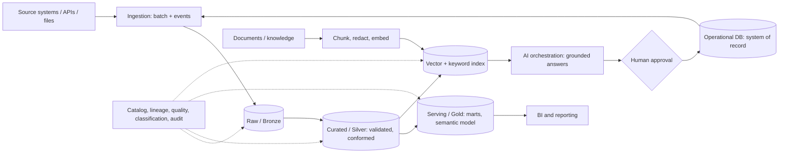
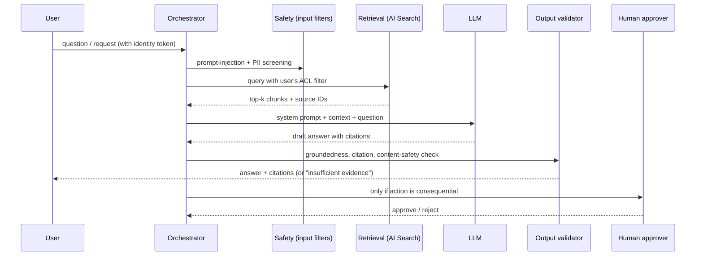

# Data Architecture (with AI design)

Owner: Data and AI Engineer. Status: Draft v0.1 (baseline, pre-discovery).

Labels: **[Fact]** Confirmed fact, **[Calc]** Calculated, **[Fcst]** Forecast, **[Assume]** Assumption, **[Rec]** Recommendation, **[Decide]** Decision required.

## 1. Basis and evidence

- [Fact] AgentZ/claude.md project fields (name, customer, industry, problem, users, geography, cloud, compliance, budget, systems) are all unfilled placeholders.
- [Fact] The AgentZ folder holds no source code, schemas, datasets or data documentation. It only holds claude.md, agent role files and docs/delivery/ROSTER.md.
- [Fact] No metrics, test results or approvals exist. None are claimed here.
- Result: this document is a reversible baseline design. It must be re-validated when the project fields are filled.

## 2. Assumptions

| ID | Assumption | Impact if wrong |
|---|---|---|
| A1 | Preferred cloud is Azure (the charter is Microsoft-centric). | Service mapping in section 5 changes. |
| A2 | Data is mixed: transactional (system of record), documents (unstructured) and analytics. | Store choices change. |
| A3 | Some personal data (PII) will be processed. Regulation is unknown (GDPR, DPDP, HIPAA and others are possible). | Residency, retention and consent controls tighten. |
| A4 | Multi-tenant or multi-customer isolation may be required. | Partition and key strategy change. |
| A5 | AI features are assistive (retrieval, summarization, drafting). Any consequential action needs human approval. | Autonomy level and controls change. |
| A6 | Existing source systems are unknown and are integrated through APIs or batch extracts. | Ingestion design changes. |

## 3. Data principles

1. Classify first: every dataset has a class (Public, Internal, Confidential, Restricted/PII) and a named owner before ingestion.
2. One system of record per entity. Analytics and AI stores are derived and rebuildable.
3. Least privilege, with managed identities and no embedded credentials.
4. Encryption in transit and at rest. Customer-managed keys for Restricted data [Rec].
5. Lineage, quality checks and audit logging are mandatory on every pipeline.
6. No PII, secrets or regulated data in prompts, logs, samples or documentation unless explicitly authorized.
7. Prefer open formats (Parquet or Delta, PostgreSQL) to limit lock-in.

## 4. Logical data architecture

### Domain model (placeholder, to be replaced by BA/PO requirements)

Core entities [Assume]: User/Identity, Organization/Tenant, Customer, Transaction/Order, Document, AuditEvent, AIInteraction.
Rules: each entity has a stable surrogate key, `created_at`, `updated_at`, `source_system`, `classification`, and soft-delete or retention flags.

## 5. Technology mapping (Azure assumed, alternatives noted)

| Layer | Choice [Rec] | Alternatives | Exit strategy |
|---|---|---|---|
| Operational store | Azure SQL or PostgreSQL Flexible Server | Cosmos DB (only for justified document or global-scale needs) | Standard SQL, export with BACPAC or pg_dump |
| Lake / analytics | ADLS Gen2 + Delta/Parquet, Fabric/OneLake if licensed | Synapse, Databricks | Open formats |
| Ingestion / orchestration | Data Factory or Fabric pipelines; Event Hubs/Service Bus for events | Airflow | Pipeline definitions in Git |
| Search / vectors | Azure AI Search (hybrid keyword + vector) | pgvector for small scale | Embeddings are rebuildable from source |
| Cache | Redis, only if latency requires | None | Disposable |
| BI | Power BI | Any SQL-capable BI | Semantic model in Git |
| Governance | Microsoft Purview (catalog, lineage, classification) | OpenLineage + catalog | Metadata export |
| Secrets/keys | Key Vault, managed identity | n/a | n/a |

Cost: [Fcst] not estimated; no volumes are known. [Decide] Provide data volumes, growth rate and user counts so FinOps can model cost before any provisioning.

## 6. Data lifecycle and quality

- **Zones**: Raw (immutable, append-only) to Curated (validated, deduplicated, typed) to Serving (business-ready).
- **Quality gates** per pipeline: schema conformance, null/uniqueness/referential checks, freshness SLA, volume anomaly. Failed records go to quarantine with a reason code. Targets are set later; none are measured yet.
- **Lineage**: automated through the catalog. Each Gold metric traces to the source field, and each KPI in the future KPI_DICTIONARY.md must reference its lineage.
- **Retention**: [Decide] Legal and compliance must set periods. Default proposal is Raw 13 months, Curated 3 years, audit logs 7 years, AI interaction logs 90 days (redacted).
- **Backup/DR**: operational store with point-in-time restore and zone redundancy. RPO/RTO are [Decide] (proposal: RPO 15 min, RTO 4 h for the system of record; analytics rebuilt from raw).
- **Environments**: dev, test, staging and prod are separated. Non-prod uses synthetic or masked data only.

## 7. Security, privacy and access

- Classification labels are applied at ingestion and enforced through RBAC/ABAC, row-level security (tenant isolation) and column masking for PII.
- Access uses Entra ID groups, with just-in-time elevation for admins. Service-to-service access uses managed identities.
- Private endpoints only. No public data-plane access.
- Privacy: record of processing, DPIA or privacy impact assessment before go-live [Decide], subject-rights (access/erasure) procedure that reaches Raw, Curated and the vector index.
- Audit: all reads of Restricted data and all admin actions are logged to a central, tamper-evident store.

## 8. AI design

### 8.1 Pattern

Retrieval-augmented generation (RAG) with an orchestrator (Semantic Kernel or Foundry Agent Service) over Azure OpenAI. The model never receives the whole data estate. It receives only the retrieved, permission-trimmed context for the current user.

### 8.2 Grounding controls

- Answers must cite retrieved sources (document ID and passage). No citation or low retrieval score means respond "insufficient evidence", not a guess.
- Retrieval is filtered by the caller's entitlements (document-level ACL stored with each chunk). The index is never queried with a service identity that bypasses user permissions.
- Chunking: structure-aware, with metadata (source, version, classification, owner, effective date). PII is redacted before embedding where policy requires.
- Index refresh is event-driven. Deletions in the source propagate to the index within an agreed SLA [Decide].

### 8.3 Safety and responsible AI

| Risk | Control |
|---|---|
| Prompt injection (user or in retrieved docs) | Treat retrieved text as data, never as instructions. Use Prompt Shields/content filters, strip active content, and allowlist tools. |
| Data leakage / over-sharing | ACL-trimmed retrieval, output PII scan, no cross-tenant index sharing. |
| Hallucination | Grounded-only answering, groundedness scoring, abstain path. |
| Harmful content | Azure AI Content Safety on input and output. |
| Bias/fairness | Assess only if outputs affect people (eligibility, ranking, HR). Not yet determined [Decide]. |
| Excessive agency | Agents get least-privilege, scoped tools. Write actions are proposals until approved. |
| Model drift or vendor change | Pin model and version, regression-test on every change, keep prompts in Git. |

### 8.4 Human approval

Consequential actions (data changes, external communications, financial or contractual commitments, access changes, deletions) require explicit human approval. The approval request shows the proposed action, reason, expected benefit, cost, risk, rollback, validation plan and approver. The agent cannot self-approve. Approval records are written to the audit log.

### 8.5 Evaluation (design only; nothing has been run)

- Golden dataset: curated Q&A with expected sources, built with business SMEs. [Decide] needs an SME owner. Initial size proposal is 100 to 200 items covering normal, ambiguous, adversarial (injection) and out-of-scope cases.
- Metrics (targets to be agreed, none measured): groundedness, citation accuracy, answer relevance, retrieval recall@k, refusal correctness, content-safety block rate, latency p95, cost per interaction.
- Gates: offline eval must pass in CI before any prompt, model, index or chunking change is promoted. Online: sampled human review plus thumbs feedback feeding the backlog.
- Red-team: injection, jailbreak and data-exfiltration test set run before release and after material changes.

### 8.6 Operations and governance

- Version and register models, prompts, tool definitions, eval sets and index schemas. Each answer logs their versions.
- Log (redacted): request ID, user ID hash, retrieved source IDs, model/prompt version, safety verdicts, latency, tokens, approval events. Do not log raw PII.
- Kill switch: feature flag per AI capability, plus a global switch to disable generation while keeping search. Rollback to the previous prompt/model version through config.
- Cost control: token budgets per user and per day, caching, smaller model for routing or classification, with alerts to FinOps.

## 9. Observability

Pipeline success rate, freshness, row-count and quality-failure rates, query performance, index lag, AI latency/cost/refusal rate/groundedness sample scores. Dashboards and alerts live in Azure Monitor. Owners are assigned per dataset and pipeline.

## 10. Risks

| ID | Risk | Rating | Mitigation |
|---|---|---|---|
| R1 | Project context is unknown, so the design may not fit. | High | Fill claude.md fields and run discovery, then revise this document. |
| R2 | Regulated data is present but unclassified. | High | Classification workshop before ingestion. |
| R3 | Source-system data quality is poor. | Medium | Profile early. Quality gates and quarantine. |
| R4 | The AI answers are wrong or leak data. | High | Section 8 controls and eval gates. |
| R5 | Cost overruns from tokens or the lake. | Medium | Budgets, forecasts, scheduled shutdown. |

## 11. Decisions and approvals required

| # | Decision | Needed from |
|---|---|---|
| D1 | Confirm cloud, regulatory scope, data residency | Sponsor, Security, Legal |
| D2 | Data volumes, growth, source systems and owners | Business, Solution Architect |
| D3 | Retention periods and RPO/RTO | Compliance, Operations |
| D4 | SME owner for the evaluation dataset | Product Owner |
| D5 | Whether AI outputs affect individuals (fairness assessment) | Product Owner, Security |

Approval required before: provisioning any paid service, accessing real or confidential data, production data migration, or enabling any AI write action. Request format: action, reason, benefit, cost, risk, rollback, validation, approver.

## 12. Next steps (safe and reversible)

1. [Rec] Fill project fields and answer D1 to D5.
2. [Rec] Produce a data inventory and classification register template.
3. [Rec] Draft logical schema once REQUIREMENTS.md exists.
4. [Rec] Build the golden eval set skeleton using synthetic data.
5. [Rec] Estimate cost with the FinOps role once volumes are known.
