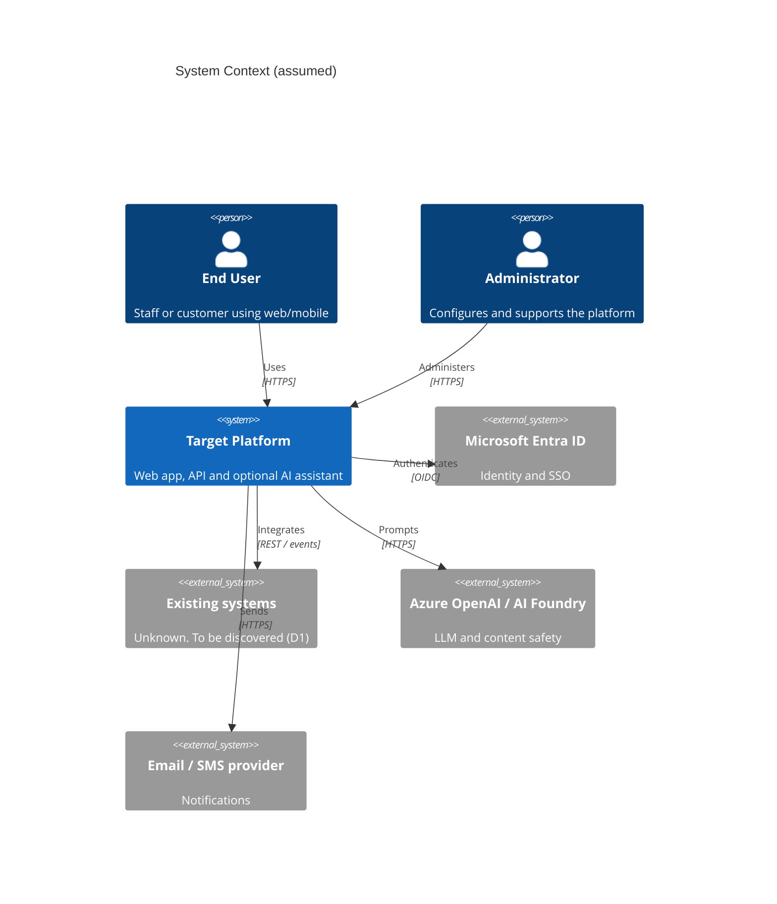
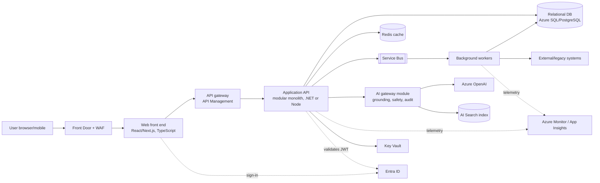
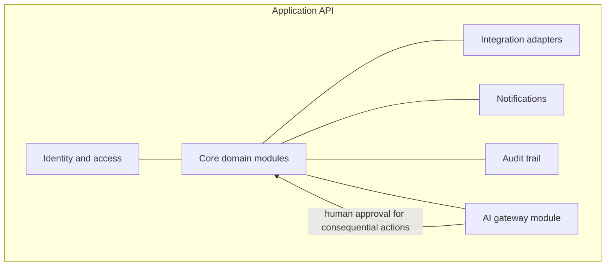
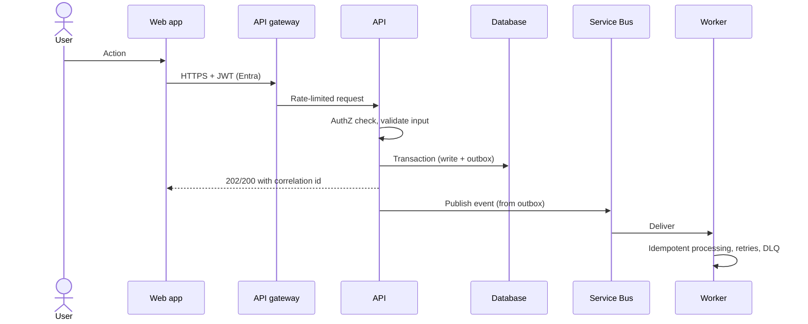
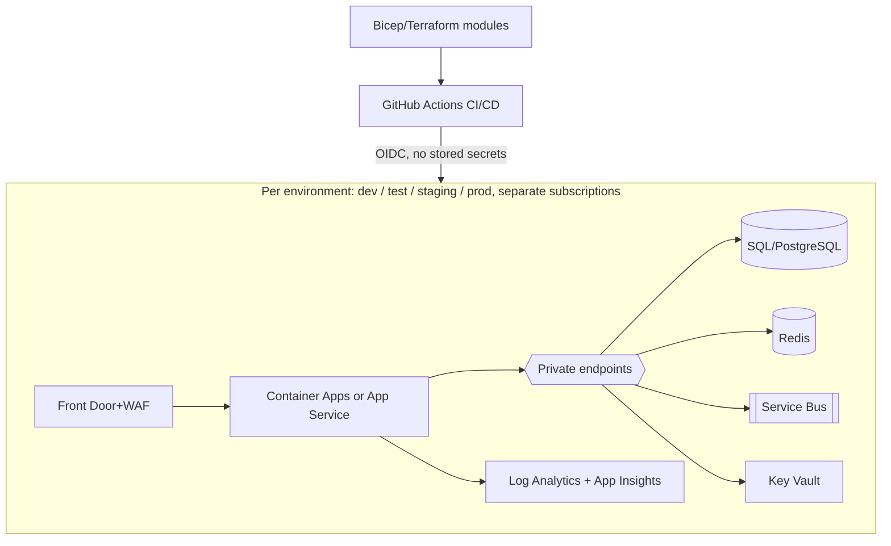

# Solution Architecture (Initial, Reference Baseline)

Owner: Solution and Technical Architect | Status: Draft v0.1 | Date: 2026-11-05

## 1. Evidence base and labels

Labels used: **Confirmed fact**, **Assumption**, **Recommendation**, **Decision required**.

- **Confirmed fact:** AgentZ/claude.md has every project field unfilled (name, customer, industry, problem, users, geography, outcomes, timeline, budget, commercial model, cloud, constraints, phase).
- **Confirmed fact:** AgentZ contains only agent definitions (.claude/agents), claude.md and docs/delivery/ROSTER.md. It has no application source, infrastructure code or tests.
- **Confirmed fact:** The surrounding git status shows untracked sibling folders (UniversalTravelEcosystem, measureMate, and others) and deleted travel-app files. Nothing in AgentZ links to them. They were not analysed and are out of scope.
- No progress, metrics, cost figures or test results exist, and none are claimed here.

## 2. Assumptions (all reversible)

| ID | Assumption | Impact if wrong |
|---|---|---|
| A1 | The target is a greenfield, web-first enterprise application with APIs, a relational store and an optional AI assistant capability. | Re-baseline the logical view. |
| A2 | Cloud is Azure-primary, with Microsoft Entra ID for identity. Chosen because claude.md lists Microsoft technologies first. No multi-cloud. | Swap the physical view. The logical view is unchanged. |
| A3 | Delivery phase is Discovery/Architecture. | Scope of this document. |
| A4 | Users are internal staff plus external customers, in one region initially. | Residency and DR design. |
| A5 | Data may include PII but no regulated (PCI/PHI) data until confirmed. | Raises the control baseline. |
| A6 | A modular monolith plus a few async workers, not microservices, until scale evidence justifies a split. | See ADR-S02. |

## 3. Decisions required from humans

| ID | Decision | Why it matters | Approver |
|---|---|---|---|
| D1 | Fill in the project fields in claude.md (problem, outcomes, users, geography, budget, cloud, compliance). | Every NFR target below is provisional until then. | Sponsor / Delivery Lead |
| D2 | Confirm the cloud and compliance regime (A2, A5). | Drives the physical design and the control set. | Sponsor, Security |
| D3 | Approve cloud spend before any provisioning. | claude.md section 12. | Finance / Sponsor |

## 4. Context (C4 level 1)

## 5. Containers (C4 level 2)

## 6. Logical components

Design rules (Recommendation):
- API-first with OpenAPI contracts. Every integration sits behind an adapter and has an anti-corruption layer.
- Each module owns its tables. No cross-module table access.
- Every consequential AI action needs human approval and is audited. This follows claude.md section 11.

## 7. Key flows

## 8. Deployment view (physical, Azure, assumed)

Prod deployment, identity changes and spend need explicit human approval (claude.md section 12).

## 9. Architecture decisions (summary)

| ID | Decision | Alternatives | Rationale | Exit / reversal |
|---|---|---|---|---|
| ADR-S01 | Azure-primary (A2) | AWS, GCP, multi-cloud | Microsoft stack alignment. Multi-cloud complexity is not justified without evidence. | Containers + IaC + OIDC/OpenAPI keep the app portable. |
| ADR-S02 | Modular monolith + workers (A6) | Microservices | Smaller team, lower ops cost, clear module seams for later extraction. | Extract a module behind its existing API and events. |
| ADR-S03 | Relational DB as system of record, with an outbox for events | Cosmos DB, event sourcing | Transactional integrity. | Outbox lets the broker be swapped. |
| ADR-S04 | Entra ID, OIDC, managed identities | Custom auth | Zero Trust and no secrets in code. | The IdP sits behind a standard OIDC interface. |
| ADR-S05 | AI via a controlled gateway module | Direct LLM calls from features | One place for grounding, content safety, PII filtering, audit and a kill switch. | Feature flag disables AI. Model is swappable. |

Each ADR needs the full record (costs, risks, security/ops/business impact) in docs/decisions once D1 and D2 are resolved.

## 10. Requirement traceability (skeleton)

| Outcome | Requirement | Design element | Test | Status |
|---|---|---|---|---|
| Unknown (D1) | Unknown | Sections 5-8 | Not yet defined | Not started |

Fill this in when REQUIREMENTS.md exists. See NON_FUNCTIONAL_REQUIREMENTS.md for the quality attributes.

## 11. Next steps (Recommendation)

1. Resolve D1 and D2.
2. Create INTEGRATION_ARCHITECTURE.md after the existing-systems inventory.
3. Hand the security view to the Security Architect and the data view to the Data/AI Engineer.
4. Produce a cost estimate before any provisioning (D3).
