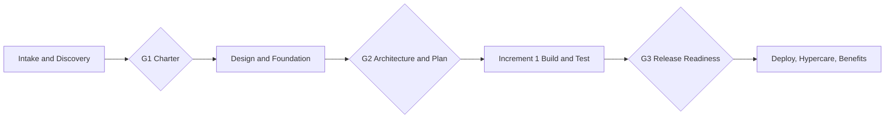

# Delivery Plan (Initial Draft v0.1)

Owner: Delivery Lead | Date: 2026-11-05 | Status: Draft, pending human review
Labels used: **[Fact]** Confirmed fact, **[Calc]** Calculated, **[Fcst]** Forecast, **[Assump]** Assumption, **[Rec]** Recommendation, **[Dec]** Decision required.

## 1. Evidence base

- [Fact] AgentZ contains only `claude.md` (operating charter), 12 role definitions in `.claude/agents/`, and `docs/delivery/ROSTER.md` (empty table). No source code, infrastructure, tests, pipelines, or prior documentation exist in AgentZ.
- [Fact] All project fields in claude.md section 1 (name, customer, industry, problem, users, geography, outcomes, timeline, budget, commercial model, cloud, systems, security, compliance, team size, constraints, repo path, phase) are unfilled placeholders.
- [Fact] No progress, metrics, approvals, or test results exist. None are reported here.
- [Fact] The parent git repo has unrelated, untracked project folders (e.g. UniversalTravelEcosystem, measureMate). Nothing indicates they are in scope for AgentZ. [Assump] They are out of scope until the sponsor says otherwise.

## 2. Assumptions (all reversible, to be confirmed)

| ID | Assumption | Impact if wrong | Confirm with |
|---|---|---|---|
| A1 | Current phase is Discovery / Mobilization (nothing built yet) | Plan re-baseline | Sponsor |
| A2 | AgentZ is the AI delivery unit itself; the first work product is the delivery framework, not a customer solution | Scope change | Sponsor |
| A3 | Commercial model unknown; plan is effort-based and cost-neutral (no figures committed) | Financial model rework | Finance |
| A4 | Cloud and Microsoft stack unknown; no architecture selection is made yet | Architecture rework | Architect |
| A5 | Work stays in local/non-production; no spend, no deployment | Approvals needed earlier | Sponsor |
| A6 | Planning horizon starts 2026-11-09 (Monday); Day 90 is about 2027-02-05 | Dates shift | Sponsor |
| A7 | AI roles produce drafts; a named human reviews and approves each gate | Governance gap | Sponsor |

## 3. Critical missing information

1. Project name, customer, business problem, and target users (blocks Discovery and Business Case).
2. Expected business outcomes and baselines (blocks benefits framework).
3. Timeline, approved budget, commercial model (blocks cost model and staffing).
4. Cloud preference, existing systems, security and compliance requirements (blocks architecture).
5. Repository or system to be delivered against (blocks engineering work).
6. Named human sponsor and approvers for each gate.

## 4. 30/60/90-day plan (Forecast, effort-based, dates indicative)

### Days 1-30: Discover and mobilize (to about 2026-12-04)
| Work item | Objective | Owner role | Acceptance criteria |
|---|---|---|---|
| Intake of project facts | Fill claude.md section 1 | Delivery Lead + BA/PO | All critical gaps in section 3 closed or assumption-logged |
| Charter and outcome map | Tie work to business outcomes | BA/PO, Delivery Lead | Sponsor-reviewed PROJECT_CHARTER.md, OUTCOME_MAP.md |
| Requirements and NFRs baseline | Scope definition | BA/PO | REQUIREMENTS.md, NON_FUNCTIONAL_REQUIREMENTS.md draft |
| RAID, decision, change logs | Governance controls | PMO Analyst | Logs created, reviewed weekly |
| Security and architecture principles | Guardrails before build | Security, Enterprise Architect | Threat-model scope, ADR template, data classification |
| Cost and staffing first cut | Budget realism | Finance/Workforce | STAFFING_PLAN.md, cost model with stated assumptions |
| Gate G1: Charter and scope approval | Human approval | Sponsor | Written approval recorded in DECISION_LOG.md |

### Days 31-60: Design and foundation (to about 2027-01-08)
| Work item | Objective | Owner role | Acceptance criteria |
|---|---|---|---|
| Solution, security, data, cloud architecture | Target state | Solution/Enterprise Architect, Cloud | Architecture docs and ADRs reviewed |
| Test strategy and DevSecOps plan | Quality by design | QA, Cloud/DevOps/SRE | TEST_STRATEGY.md; pipeline design |
| Delivery foundation in non-production | Repo, CI skeleton, branch protection | Full-stack, DevOps | Pipeline runs build and tests locally or in dev; evidence captured |
| Backlog with priority scores (claude.md s16) | Sequencing | BA/PO | Scored backlog, release plan v1 |
| FinOps plan and baseline benefits | Measurability | Finance, PMO | FINOPS_PLAN.md, KPI_DICTIONARY.md with baselines and sources |
| Gate G2: Architecture and plan approval | Human approval | Sponsor, Architect | Recorded approval |

### Days 61-90: Build first increment and prove value (to about 2027-02-05)
| Work item | Objective | Owner role | Acceptance criteria |
|---|---|---|---|
| Increment 1 in non-production | Thin end-to-end slice | Full-stack, Data/AI | Acceptance criteria met with test evidence |
| Automated tests and security scans | Quality evidence | QA, Security | Reports attached; open Sev1/Sev2 listed |
| Operational readiness draft | Run model | SRE, Support Lead | RUNBOOK.md, SUPPORT_MODEL.md drafts |
| Change and training outline | Adoption | Change/Support Lead | Comms and training plan (not sent externally) |
| First executive status and benefits check | Evidence-based reporting | Delivery Lead, PMO | EXECUTIVE_STATUS.md with KPI table populated from real data |
| Gate G3: Production-readiness decision | Human approval | Sponsor | Go/no-go recorded; no production deployment without it |

## 5. Roadmap (phases and gates)

| Phase | Window (Fcst) | Exit criteria | RAG |
|---|---|---|---|
| Discovery and mobilization | Days 1-30 | G1 approved | Amber: project inputs missing |
| Design and foundation | Days 31-60 | G2 approved | Not started |
| Increment 1 | Days 61-90 | G3 decision | Not started |
| Release, hypercare, benefits | After Day 90, dates TBD | Adoption and benefits evidence | Not started |

Overall RAG: **Amber** [Fact-based]. Reason: no work is at risk yet, but critical inputs (section 3) are missing and active mitigation (intake) is required. Nothing is Green because no progress is evidenced.

## 6. Initial risks

| ID | Risk | Rating | Mitigation |
|---|---|---|---|
| R1 | Missing project facts lead to wrong scope | High | Intake in first week; assumptions logged |
| R2 | No named human approvers; AI outputs go unreviewed | High | Name sponsor and gate approvers (D1) |
| R3 | Budget and commercial model unknown | Medium | Keep cost model assumption-based; no external figures |
| R4 | Unrelated folders in parent repo cause scope confusion | Low | Confirm scope in intake |

## 7. First five actions

1. [Rec] Collect project facts: send the claude.md section 1 questionnaire to the sponsor (prepared internally; sending needs the human's decision).
2. [Rec] Name human sponsor and gate approvers; record in DECISION_LOG.md.
3. [Rec] BA/PO drafts PROJECT_CHARTER.md and OUTCOME_MAP.md from intake answers, with baselines and data sources.
4. [Rec] PMO Analyst creates RAID_LOG.md, DECISION_LOG.md, CHANGE_LOG.md seeded with section 3 and section 6 items.
5. [Rec] Security and Enterprise Architects define guardrails (data classification, ADR template, approval model) before any build.

## 8. Approvals required

| # | Action | Reason | Benefit | Cost | Risk | Rollback | Validation | Approver |
|---|---|---|---|---|---|---|---|---|
| D1 | Confirm sponsor and approvers | Gates need accountable humans | Valid governance | None | Delay if unanswered | n/a | Names recorded in DECISION_LOG.md | Program owner |
| D2 | Confirm scope of AgentZ vs. other repo folders | Avoid wrong work | Focused plan | None | Rework | n/a | Written scope statement | Sponsor |
| D3 | Release of any external communication (questionnaire, status to customer) | Charter forbids external sending without approval | Intake progress | None | Misstatement | Retract draft | Human review of draft | Sponsor |
| D4 | Any cloud purchase, licence, or spend | Not yet needed | Enables Days 31+ foundation | TBD | Budget breach | Cancel/deprovision | Cost estimate approved first | Budget owner |
| D5 | Hiring or staffing changes | None proposed | n/a | TBD | n/a | n/a | n/a | Resourcing owner |
| D6 | Production deployment, data migration, access changes | Not in scope before G3 | n/a | TBD | High | Per release plan | G3 evidence | Sponsor and Ops owner |

D1 to D3 are needed to proceed beyond Day 7. D4 to D6 are not requested now.

## 9. Not done / not claimed

No external communication sent, nothing deployed, no spend, no tests run. No financial, benefit, or progress figures are asserted.
