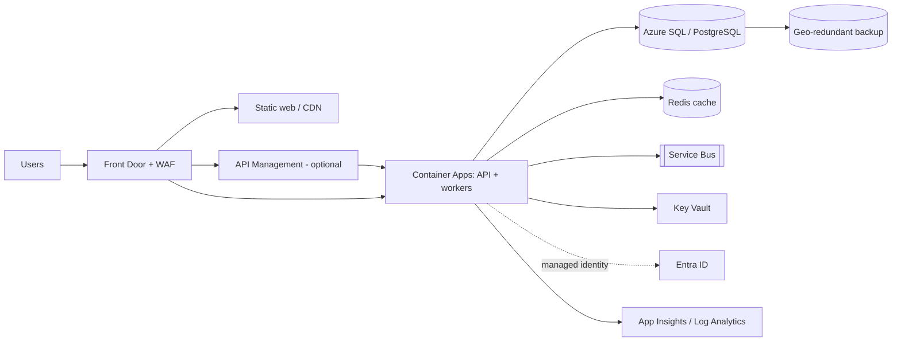

# Cloud Architecture (Baseline Proposal)

Owner: Cloud, DevOps and SRE Engineer. Status: Draft for review. Nothing described here has been provisioned.

Labels used: **[Fact]** Confirmed fact, **[Calc]** Calculated, **[Forecast]**, **[Assumption]**, **[Rec]** Recommendation, **[Decision]** Decision required.

## 1. Evidence base

- [Fact] AgentZ contains only `claude.md`, 11 agent definitions under `.claude/agents/`, and `docs/delivery/ROSTER.md`. There is no application source, IaC, pipeline, or runtime in AgentZ.
- [Fact] All project fields in `claude.md` section 1 (project, customer, cloud, budget, compliance, team size, phase) are unfilled placeholders.
- [Fact] No existing cloud accounts, subscriptions, or environments have been inspected or confirmed.
- Consequence: this document is a reference architecture built on assumptions. It must be re-baselined once the project fields and a target workload are supplied.

## 2. Assumptions

| ID | Assumption | Impact if wrong |
|---|---|---|
| A1 | Preferred cloud is Azure, with GitHub Actions for CI/CD (claude.md emphasises Microsoft stack) | Service names change; patterns stay |
| A2 | Workload is a typical web app: SPA frontend, stateless API, relational DB, async messaging | Compute and data choices change |
| A3 | Single primary region, with a paired region for backup and DR only | Cost and RTO change |
| A4 | Contains no regulated data until classified otherwise (no PCI, PHI) | Landing zone, network and audit scope grow |
| A5 | Small team (under 10), so low operational overhead is preferred | AKS may become justified |
| A6 | No multi-cloud requirement. [Rec] Do not adopt multi-cloud without a regulatory, customer, or capability reason | Complexity and cost rise |

## 3. Target architecture (Azure reference)

### Service choices and rationale

| Layer | Choice | Alternatives | Why / exit |
|---|---|---|---|
| Edge | Front Door + WAF | App Gateway | Global edge, TLS, WAF in one service. Exit: any CDN/WAF |
| Compute | Azure Container Apps | App Service, AKS | Scale-to-zero, low ops. Containers keep it portable to AKS/EKS/GKE |
| Data | Azure SQL or PostgreSQL Flexible (decision pending) | Cosmos DB | Relational default. [Decision] confirm after data model review |
| Messaging | Service Bus | Event Grid | Reliable queues and DLQ. Added only if async flows exist |
| Secrets | Key Vault + managed identity | none | No credentials in code or config |
| Identity | Entra ID (workforce and/or External ID) | Auth0 | Per Microsoft-first standard |
| Observability | Azure Monitor, Log Analytics, App Insights | Grafana/Prometheus | Native; OpenTelemetry used so telemetry is portable |

[Rec] Defer API Management, Redis and Service Bus until a requirement justifies each one (claude.md: no unnecessary services).

## 4. Environments

| Env | Purpose | Sizing | Data | Availability |
|---|---|---|---|---|
| dev | Integration by engineers | Minimum SKUs, scale-to-zero | Synthetic only | Office hours, auto-shutdown |
| test | Automated and QA testing | Small | Synthetic or masked | Office hours |
| staging | Production mirror for release validation and perf test | Production topology, reduced scale | Masked | On demand |
| prod | Live | Zone-redundant | Real | 24x7 |

- Separate subscriptions per environment group (non-prod, prod) under a management group with Azure Policy assignments. [Rec]
- Production data must never be copied to non-prod without approval and masking.

## 5. Network and security baseline

- Hub-and-spoke is not needed at this scale. [Rec] One VNet per environment, with Container Apps environment in a VNet, private endpoints for data stores and Key Vault, public access disabled on data services.
- Ingress only through Front Door (restrict origin by Front Door ID header/Private Link).
- Egress control through NAT gateway or firewall once a requirement exists. [Decision] firewall adds roughly a fixed monthly cost.
- Encryption in transit (TLS 1.2+) and at rest (platform-managed keys; customer-managed keys only if compliance requires).
- Defender for Cloud (CSPM at minimum) enabled. Sentinel is [Decision], dependent on compliance scope.
- Mandatory tags: `owner`, `application`, `environment`, `cost-center`, `lifecycle`, enforced by Azure Policy (deny or modify).

## 6. Infrastructure as Code

- Tool: Bicep (Azure-only, A1) or Terraform if multi-cloud arises. [Decision]
- Layout (per claude.md section 14): `/infrastructure/azure`, `/infrastructure/modules`, `/infrastructure/environments/{dev,test,staging,prod}`.
- Modules are versioned. Environments differ only by parameter files.
- State (if Terraform) in a locked, private storage account. Pipeline identity uses OIDC federation, with no stored secrets.
- Changes: PR, `what-if`/`plan` output posted to PR, policy check, review, apply. Production apply needs manual approval.

## 7. Reliability: SLOs, backup, DR

All targets below are [Assumption] proposals pending business input.

| Item | Proposed target |
|---|---|
| Availability SLO (API, prod) | 99.9% monthly, which is about 43 min of error budget [Calc: 0.1% x 43,200 min = 43.2 min] |
| Latency SLO | p95 under 500 ms for read endpoints |
| RPO / RTO (prod data) | RPO 15 min / RTO 4 h |
| Backup | Point-in-time restore 14 days, geo-redundant backup, monthly restore test |
| DR pattern | Backup and restore, plus IaC redeploy in the paired region (cheapest tier that meets RTO 4 h). Warm standby only if RTO tightens |
| Resilience | Zone-redundant data and compute in prod, health probes, retries with backoff, circuit breakers |

[Fact] None of these targets has been tested. DR readiness is **Not started**.

## 8. Observability

- OpenTelemetry instrumentation, with structured JSON logs, correlation IDs, and no PII or secrets in logs.
- Golden signals dashboards (latency, traffic, errors, saturation) per service.
- Alerts are symptom-based and tied to SLO burn rate (fast burn 14.4x over 1 h and slow burn 6x over 6 h are standard starting thresholds [Rec]). Each alert links to a runbook.
- Synthetic availability probe against the prod health endpoint.
- Log retention: 30 days hot, 90 to 365 days archive. [Decision] depends on compliance.
- Planned artifacts in `/monitoring` and `/runbooks`. `RUNBOOK.md` is not yet written.

## 9. Operating model

- Incident severity: Sev1 (outage or data risk), Sev2 (major degradation), Sev3 (minor). On-call and escalation owners are [Decision] and have not been assigned.
- Blameless post-incident review for every Sev1 and Sev2. Actions go to RAID log.
- Change management is through PR and pipeline. Emergency changes are retro-reviewed within 2 business days.

## 10. Decision records (summary)

| ID | Decision | Status |
|---|---|---|
| ADR-C1 | Azure as primary cloud (A1) | Proposed, needs customer confirmation |
| ADR-C2 | Container Apps over AKS/App Service | Proposed |
| ADR-C3 | Bicep vs Terraform | Open |
| ADR-C4 | Data store engine | Open |
| ADR-C5 | DR pattern: backup/restore | Proposed |

Reversal: containerised workloads and OpenTelemetry keep compute and telemetry portable. Data export via standard SQL tools.

## 11. Approval-gated actions (nothing executed)

| Action | Reason | Benefit | Cost | Risk | Rollback | Validation | Approver |
|---|---|---|---|---|---|---|---|
| Create subscriptions/resource groups for dev | Enable first deploy | Working non-prod | See FINOPS_PLAN (dev estimate) | Low | Delete dev resource group (itself needs approval) | Policy compliance scan, tag check | Customer cloud owner / Delivery Lead |
| Assign Azure Policy baseline | Enforce tags and guardrails | Governance | Negligible | May block non-compliant deploys | Remove assignment | Audit mode first, then deny | Security Architect + cloud owner |
| Production landing zone | Prerequisite for go-live | Production readiness | See FINOPS_PLAN | Medium | Tear down before data lands | Well-Architected review | Customer sponsor |

## 12. Open questions (material only)

1. Which cloud, and are there existing subscriptions or landing zones?
2. What is the target workload, and where is its source repository?
3. Data classification and compliance regimes (GDPR, SOC 2, ISO 27001, sector rules)?
4. Availability and RTO/RPO expectations from the business?
5. Approved budget and approval threshold for cloud spend?
