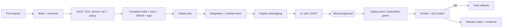

# DevSecOps Pipeline Plan

Owner: Cloud, DevOps and SRE Engineer. Status: Draft. No pipelines exist or have been run.

Labels: [Fact], [Calc], [Forecast], [Assumption], [Rec], [Decision].

## 1. Evidence base

- [Fact] AgentZ has no source code, pipeline files, tests, or IaC, so there is nothing to build or scan yet. No pipeline result is claimed here.
- [Assumption] GitHub and GitHub Actions are the platform (Azure DevOps is the alternative, [Decision]). Stack-specific tool names below are placeholders to adapt once languages are known.
- Planned locations: `/pipelines`, `.github/workflows`, `/scripts`.

## 2. Principles

Small reversible changes, automation before manual steps, immutable artifacts, least privilege, no long-lived secrets, evidence captured per release, human approval before production.

## 3. Branching and repository controls

| Control | Setting |
|---|---|
| Default branch | `main`, protected |
| Merge | PR only, squash, linear history |
| Reviews | 1 approval minimum, 2 for `/infrastructure` and `/pipelines`, CODEOWNERS enforced, author cannot approve own PR |
| Required checks | Build, unit tests, lint, SAST, SCA, secret scan, IaC validation, policy check |
| Commit signing | Recommended [Rec] |
| Versioning | Semantic versioning via tags, and artifacts tagged with version and commit SHA |

## 4. Pipeline stages

| Stage | Purpose | Tool (proposed) | Gate |
|---|---|---|---|
| Build and unit test | Compile, test, coverage | Native toolchain | Fail on test failure. Coverage threshold [Decision] |
| Static analysis | Code defects, OWASP Top 10 | CodeQL | Block on High/Critical |
| SCA | Vulnerable dependencies and licences | Dependabot + dependency review action | Block on Critical, High needs a dated waiver |
| Secret scanning | Leaked credentials | GitHub secret scanning + push protection, gitleaks | Block any finding |
| IaC validation | Syntax and misconfiguration | `bicep build` / `terraform validate`, Checkov or PSRule | Block High |
| Policy as code | Tags, regions, SKUs, public access | Azure Policy, OPA/Conftest | Block on violation |
| Container scan and SBOM | Image CVEs, inventory | Trivy, Syft (SPDX/CycloneDX) | Block Critical with fix available |
| Image signing | Provenance | Sigstore cosign, build provenance attestation | Deploy only signed images |
| Integration and contract tests | Service behaviour | Test framework + Pact (if APIs) | Must pass |
| UI and accessibility | Regression, WCAG 2.2 AA | Playwright + axe | Must pass |
| Performance | Latency, throughput vs SLO | k6 | Compare to SLO. No regression above threshold [Decision] |
| DAST | Runtime web vulnerabilities | OWASP ZAP baseline against staging | Block High |
| Deploy | Promote the same artifact | Actions + Bicep/Terraform, OIDC | Approval gate for prod |
| Smoke and rollback | Verify health, revert on failure | Health checks, revision traffic shifting | Auto rollback on failed probe or SLO burn |
| Evidence | Audit trail | Archive reports, SBOM, approvals, run IDs | Required to close release |

[Rec] Open-source tools above are suggestions that have not been evaluated against any enterprise standard. Confirm against the customer's approved tooling.

## 5. Identity and secrets in CI/CD

- OIDC federation from GitHub to Entra ID. No stored cloud credentials or client secrets.
- Separate identity per environment, with the prod identity only usable from the `production` environment.
- Reusable workflows are pinned, and third-party Actions are pinned to commit SHAs. Workflow `permissions:` default to read-only.
- Runtime secrets live in Key Vault and are accessed through managed identity. Never in repo, images, or logs.
- Rotation of production credentials requires approval.

## 6. Release and approval model

| Env | Trigger | Approval |
|---|---|---|
| dev | Merge to `main` | None |
| test/staging | Automatic after dev passes | None, or QA lead [Decision] |
| prod | Tagged release | Named approver, separate from the author (segregation of duties), within a change window |

- Progressive delivery: canary 10% then 50% then 100%, or blue-green by revision. Feature flags decouple deploy from release.
- Rollback: shift traffic to the previous revision (target under 5 minutes [Assumption]). Database migrations must be backward-compatible (expand/contract), and production migrations need approval.
- Release notes generated from conventional commits and linked PRs.

## 7. Security governance

- Threat model per major feature (owner: Security Architect). Pen test before first production go-live [Rec].
- Vulnerability SLA proposal [Assumption]: Critical 7 days, High 30 days, Medium 90 days. Exceptions need a risk owner sign-off, and the exception is logged in RAID.
- AI features (if any) add prompt-injection tests, evaluation sets and content-safety gating to the pipeline.
- Logs and test data must be free of PII and secrets. Synthetic data only in non-prod.

## 8. DORA and pipeline metrics

No baseline exists. Measurement starts at first pipeline run.

| Metric | Baseline | Target [Assumption] |
|---|---|---|
| Deployment frequency | None measured | At least weekly to prod |
| Lead time for change | None measured | Under 1 day to staging |
| Change failure rate | None measured | Under 15% |
| Time to restore | None measured | Under 1 h |
| Pipeline duration (PR checks) | None measured | Under 15 min |

## 9. Implementation backlog (safe, reversible, no cost)

| # | Task | Dependency | Needs approval |
|---|---|---|---|
| 1 | Add `ci.yml` skeleton: build, test, secret scan, dependency review | Target repo and language | No |
| 2 | CODEOWNERS and PR template | Role owners | No |
| 3 | IaC validation workflow (no deploy) | IaC files | No |
| 4 | Container build, scan, SBOM | Dockerfile | No |
| 5 | Branch protection and Environments settings | Repo admin | Yes (repo settings change) |
| 6 | OIDC trust to cloud | Cloud subscription | Yes (identity change) |
| 7 | Deploy jobs for dev, then prod | Items 5 and 6 | Yes (prod) |

## 10. Decisions required

1. GitHub Actions or Azure DevOps?
2. Coverage and performance thresholds.
3. Approvers per environment and change windows.
4. Approved security tool list, and which scanners are licensed.
